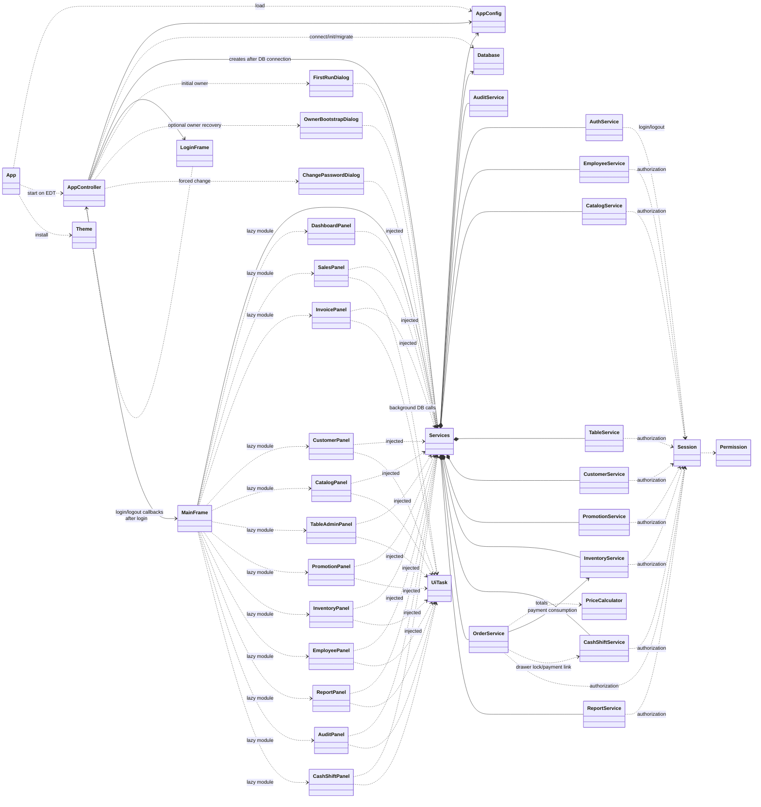
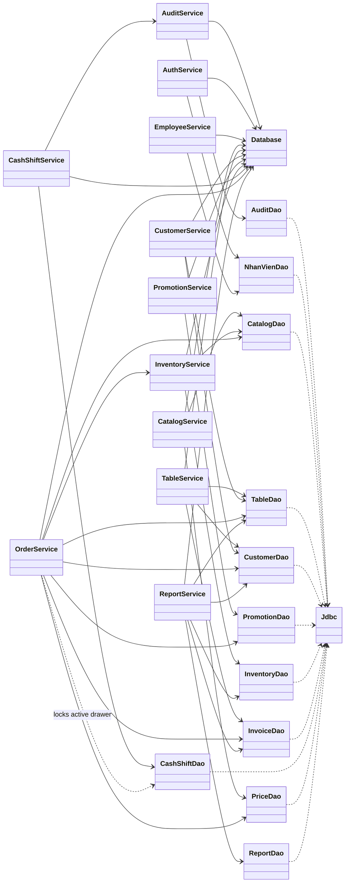
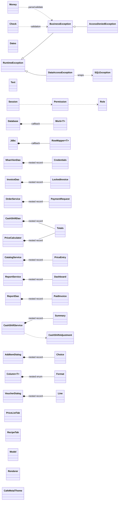
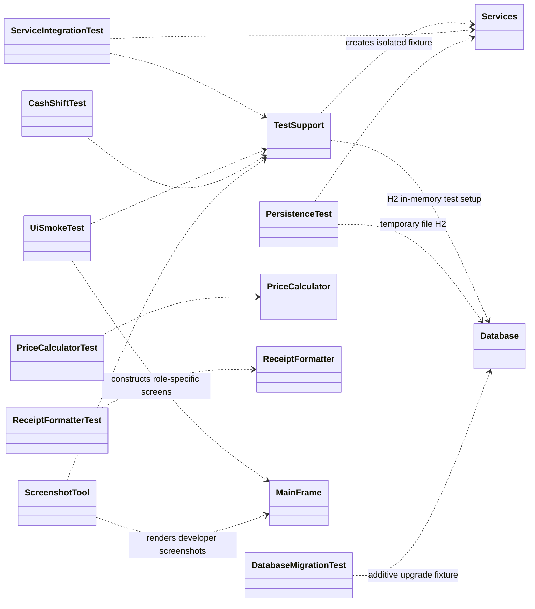

# Class Diagram — Cafe Management

Generated from the Java sources under `src/main/java` and `src/test/java`. The diagrams show Java dependencies and model composition; where a relation is enforced by a SQL foreign key rather than a Java object reference, the edge is labeled `FK`. To keep the full project legible, the class map is split by layer. `<<record>>` and `<<enum>>` identify Java declarations; Swing/JDK parent types are included where useful.

## 1. Application and service wiring

`Services` is the manual dependency container. Each module panel receives the same `Services` instance. `AppController` handles application flow; individual panels handle screen events and call services.

## 2. Service-to-DAO dependencies

All DAO SQL resides under `cafe.dao`. `Jdbc` centralizes prepared statements, parameter binding, generated keys, and result mapping. Service operations decide which work shares a `Database.tx` transaction.

## 3. Domain model and database relationships

Foreign-key edges here describe the schema-level relationship and do not imply that the Java record stores the related record object. Actual object containment (for example `InvoiceDetail` owning its line list) is marked `contains`.

```mermaid
classDiagram
direction TB
class NhanVien { <<record>> }
class Role { <<enum>> }
class NhatKy { <<record>> }
class LoaiMon { <<record>> }
class Mon { <<record>> }
class Size { <<record>> }
class Topping { <<record>> }
class BangGia { <<record>> }
class ChiTietBangGia { <<record>> }
class MenuItem { <<record>> }
class SizePrice { <<record>> }
class KhuVuc { <<record>> }
class Ban { <<record>> }
class TableStatus { <<record>> }
class TrangThaiBan { <<enum>> }
class KhachHang { <<record>> }
class DonDatHang { <<record>> }
class TrangThaiDatBan { <<enum>> }
class LoaiKhuyenMai { <<record>> }
class KhuyenMai { <<record>> }
class Thue { <<record>> }
class HoaDon { <<record>> }
class LoaiDon { <<enum>> }
class TrangThaiHoaDon { <<enum>> }
class ChiTietHoaDon { <<record>> }
class ChiTietTopping { <<record>> }
class ThanhToan { <<record>> }
class PhuongThucThanhToan { <<enum>> }
class CashShift { <<record>> }
class CashMovementKind { <<enum>> }
class CashShiftAdjustment { <<record>> }
class NguyenLieu { <<record>> }
class CongThuc { <<record>> }
class NhaCungCap { <<record>> }
class PhieuNhap { <<record>> }
class ChiTietPhieuNhap { <<record>> }
class PhieuXuat { <<record>> }
class ChiTietPhieuXuat { <<record>> }
class TrangThaiPhieu { <<enum>> }
class BienDongKho { <<record>> }
class LoaiBienDong { <<enum>> }
class InvoiceDetail { <<record>> }
class Reports { <<utility>> }
class RevenueSummary { <<record>> }
class RevenueRow { <<record>> }
class ProductSales { <<record>> }
class EmployeeSales { <<record>> }
class PaymentMethodTotal { <<record>> }
class CashierSales { <<record>> }
class TransactionRow { <<record>> }
class StockRow { <<record>> }

NhanVien --> Role
NhatKy ..> NhanVien : actor FK
Mon ..> LoaiMon : category FK
ChiTietBangGia ..> BangGia : price-list FK
ChiTietBangGia ..> Mon : product FK
ChiTietBangGia ..> Size : size FK
MenuItem *-- Mon
MenuItem *-- SizePrice
SizePrice --> Size
Ban ..> KhuVuc : area FK
TableStatus *-- Ban
TableStatus --> TrangThaiBan
DonDatHang ..> KhachHang : customer FK
DonDatHang ..> Ban : table FK
DonDatHang ..> NhanVien : creator FK
DonDatHang --> TrangThaiDatBan
KhuyenMai ..> LoaiKhuyenMai : type FK
HoaDon --> LoaiDon
HoaDon --> TrangThaiHoaDon
HoaDon ..> Ban : table FK
HoaDon ..> KhachHang : customer FK
HoaDon ..> NhanVien : creator FK
HoaDon ..> KhuyenMai : promotion FK
HoaDon ..> Thue : tax FK
ChiTietHoaDon ..> HoaDon : invoice FK
ChiTietHoaDon ..> Mon : product FK
ChiTietHoaDon ..> Size : size FK
ChiTietHoaDon *-- ChiTietTopping : contains toppings
ChiTietTopping ..> Topping : topping FK
ThanhToan ..> HoaDon : unique invoice FK
ThanhToan ..> NhanVien : cashier FK
ThanhToan ..> CashShift : cashier shift FK
ThanhToan --> PhuongThucThanhToan
CashShift ..> NhanVien : owner/closer FK
HoaDon ..> CashShift : cash refund shift FK
CashShiftAdjustment ..> CashShift : closed shift FK
CashShiftAdjustment ..> NhanVien : authorized actor FK
CongThuc ..> Mon : product FK
CongThuc ..> NguyenLieu : ingredient FK
PhieuNhap ..> NhanVien : creator FK
PhieuNhap ..> NhaCungCap : supplier FK
PhieuNhap --> TrangThaiPhieu
PhieuNhap *-- ChiTietPhieuNhap : contains lines
ChiTietPhieuNhap ..> NguyenLieu : ingredient FK
PhieuXuat ..> NhanVien : creator FK
PhieuXuat --> TrangThaiPhieu
PhieuXuat *-- ChiTietPhieuXuat : contains lines
ChiTietPhieuXuat ..> NguyenLieu : ingredient FK
BienDongKho ..> NguyenLieu : ingredient FK
BienDongKho ..> NhanVien : actor FK
BienDongKho --> LoaiBienDong
InvoiceDetail *-- HoaDon
InvoiceDetail *-- ChiTietHoaDon
InvoiceDetail o-- ThanhToan
Reports ..> RevenueSummary
Reports ..> RevenueRow
Reports ..> ProductSales
Reports ..> EmployeeSales
Reports ..> PaymentMethodTotal
Reports ..> CashierSales
Reports ..> TransactionRow
Reports ..> StockRow
```

## 4. Swing view classes and reusable UI components

```mermaid
classDiagram
direction TB
class JFrame
class JPanel
class JDialog
class Refreshable { <<interface>> +reload() }
class Services
class MainFrame
class LoginFrame
class DashboardPanel
class FirstRunDialog
class OwnerBootstrapDialog
class ChangePasswordDialog
class SalesPanel
class AddItemDialog
class PaymentDialog
class InvoicePanel
class CustomerPanel
class ReceiptDialog
class ReceiptFormatter
class CatalogPanel
class PriceListTab
class TableAdminPanel
class PromotionPanel
class InventoryPanel
class RecipeTab
class VoucherDialog
class Line
class EmployeePanel
class ReportPanel
class AuditPanel
class CashShiftPanel
class DataTable~T~
class Column~T~
class ListPanel~T~
class FormDialog
class Fields
class Dialogs
class Theme
class CafeMetalTheme
class UiTask
class Model
class Renderer
class AbstractTableModel
class DefaultTableCellRenderer
class DefaultMetalTheme

LoginFrame --|> JFrame
MainFrame --|> JFrame
DashboardPanel --|> JPanel
SalesPanel --|> JPanel
AddItemDialog --|> JDialog
PaymentDialog --|> JDialog
InvoicePanel --|> JPanel
CustomerPanel --|> JPanel
CatalogPanel --|> JPanel
PriceListTab --|> JPanel
TableAdminPanel --|> JPanel
PromotionPanel --|> JPanel
InventoryPanel --|> JPanel
RecipeTab --|> JPanel
EmployeePanel --|> JPanel
ReportPanel --|> JPanel
AuditPanel --|> JPanel
CashShiftPanel --|> JPanel
FormDialog --|> JDialog
DashboardPanel ..|> Refreshable
SalesPanel ..|> Refreshable
InvoicePanel ..|> Refreshable
CustomerPanel ..|> Refreshable
CatalogPanel ..|> Refreshable
TableAdminPanel ..|> Refreshable
PromotionPanel ..|> Refreshable
InventoryPanel ..|> Refreshable
EmployeePanel ..|> Refreshable
ReportPanel ..|> Refreshable
AuditPanel ..|> Refreshable
CashShiftPanel ..|> Refreshable
ListPanel ..|> Refreshable
PriceListTab ..|> Refreshable
RecipeTab ..|> Refreshable

MainFrame ..> Refreshable : reload visible screen
MainFrame ..> DashboardPanel : module factory
MainFrame ..> SalesPanel : module factory
MainFrame ..> InvoicePanel : module factory
MainFrame ..> CustomerPanel : module factory
MainFrame ..> CatalogPanel : module factory
MainFrame ..> TableAdminPanel : module factory
MainFrame ..> PromotionPanel : module factory
MainFrame ..> InventoryPanel : module factory
MainFrame ..> EmployeePanel : module factory
MainFrame ..> ReportPanel : module factory
MainFrame ..> AuditPanel : module factory
MainFrame ..> CashShiftPanel : module factory
SalesPanel ..> AddItemDialog
SalesPanel ..> PaymentDialog
InvoicePanel ..> ReceiptDialog
ReceiptDialog ..> ReceiptFormatter
CatalogPanel *-- ListPanel : products/categories/sizes/toppings
CatalogPanel *-- PriceListTab : price-list tab
PriceListTab *-- ListPanel
InventoryPanel *-- RecipeTab : recipe tab
VoucherDialog *-- Line : line input
ListPanel *-- DataTable
DataTable o-- Column : column definitions
Model --|> AbstractTableModel
Renderer --|> DefaultTableCellRenderer
DataTable *-- Model
DataTable *-- Renderer
FormDialog ..> Fields
LoginFrame ..> Dialogs
MainFrame ..> Theme
CafeMetalTheme --|> DefaultMetalTheme
Theme ..> CafeMetalTheme
UiTask ..> Dialogs : error presentation
```

`FirstRunDialog`, `ChangePasswordDialog`, `VoucherDialog`, `ReceiptDialog`, and `ReceiptFormatter` are utility/dialog classes rather than panels inheriting from Swing containers (their displayed dialogs are created by static methods or composed internally).

## 5. Utilities, exception hierarchy, and nested types

## 6. Test and developer-tool classes

## Source inventory covered

The diagrams cover production declarations under `src/main/java/cafe` (app, config, controller, DAO, model, service, util, and all view packages), nested records/interfaces/enums surfaced in those classes, and test/developer-tool declarations under `src/test/java/cafe`. The model diagram shows schema relations where Java records store foreign-key IDs rather than object fields. It intentionally omits trivial record attributes and JDK internals; follow the links in [`CODE_MAP.md`](CODE_MAP.md) for source navigation.
