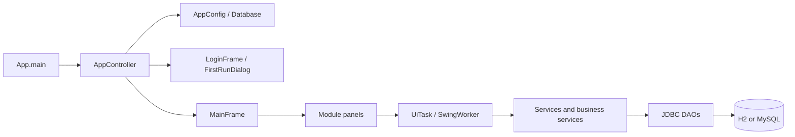

# Cafe Management System — Project Guide

## Verified status

This is a Vietnamese-language Java 17 Maven Swing application. On 22/10/2026, the full offline Maven test run completed with 52 tests, 0 failures, 0 errors, and 0 skipped. The current source was packaged successfully with offline Maven (`-DskipTests package` after the full test run). The shaded JAR retained `Main-Class: cafe.App` and initialized a new temporary H2 database; it remained running through an 8-second smoke check and was then stopped.

The 18-screen `ScreenshotTool` run completed at each of 1280×720, 1366×768, 1366×800 and 1920×1080 (72 snapshots total), and both headless `UiSmokeTest` cases succeeded. The screenshot tool calls `doClick` for module navigation and table selection; checkout, cashier forms, account forms, and other end-to-end UI actions still need manual verification. A closed copy of the default H2 file database was migrated through `Database.initializeIfEmpty` and `Database.migrate`; pre-existing table-row digests were preserved, v1/v2 schema objects were present, and a second startup did not duplicate initialization. The active `data/cafe.mv.db` was never connected to through JDBC or modified. Real MySQL, physical printer behavior, and multi-terminal deployment remain unverified.

The project has no Maven wrapper. Root `AGENTS.md` contains the repository-specific working guide. Maven was run from the IntelliJ installation with the project's offline settings.

## Technology and build

`pom.xml` sets `maven.compiler.release=17`, UTF-8, main class `cafe.App`; dependencies are FlatLaf 3.7.2, MySQL Connector/J 9.1.0, H2 2.3.232, jBCrypt 0.4, and test-scoped JUnit Jupiter 5.11.3. Compiler 3.13.0, Surefire 3.5.2 (headless AWT), Exec 3.5.0 and Shade 3.6.0 are configured. Shade creates `target/cafe-management.jar` with dependencies and a main manifest.

From the project root, intended commands are `mvn test`, `mvn clean package`, `java -jar target/cafe-management.jar`, and `mvn exec:java`. `maven-jar-plugin` is configured to recreate its thin input on each package run because Shade replaces the main artifact. Shade still reports the expected overlapping `META-INF/MANIFEST.MF`; `ManifestResourceTransformer` writes the executable `cafe.App` manifest. The package was run twice previously; the current artifact was rebuilt and smoke-launched with an explicit temporary H2 config. `ScreenshotTool` rendered 18 snapshots at each of four desktop resolutions using in-memory H2. Automated tests use isolated H2; `PersistenceTest` uses a temporary directory and cleanup.

### V2 desktop visual system

The previous pass changed some palette/font defaults but kept Metal control geometry, so tables, tabs, scroll panes and standard option dialogs still looked like classic Swing; the POS also showed the catalog as a table. V2 installs FlatLaf Light in `Theme.install()` before constructing windows, then standardizes spacing, typography, controls, tables, status badges, empty states and dialogs. The graphite shell and neutral canvas use burnt orange for primary actions. POS uses category filters and product tiles in the existing table/menu/order layout; cashier closeout previews expected, counted and variance values while typing; the dashboard gives recent transactions more width and stacks reservations/stock in a side column. All business data and actions remain service-owned.

The before/after review set is under `target/codex-ui-preview-v2/`: 18 screens at each of 1280×720, 1366×768, 1366×800 and 1920×1080, plus contact sheets. It uses in-memory H2 demo data. Pixel-size rendering does not cover Windows DPI scaling or replace interactive workflow acceptance.

## Source layout and dependency direction

All application code is under `src/main/java/cafe`; resources are under `src/main/resources`; tests and utilities are in `src/test/java/cafe`.

| Package | Responsibility |
|---|---|
| `cafe` | `App.main`: logging, config load, EDT launch. |
| `cafe.config` | `AppConfig` defaults/properties; `Database` JDBC connections, transactions, and empty-database schema initialization. |
| `cafe.model` | Immutable records and enums for Vietnamese domain entities, invoice/detail snapshots, roles/statuses, reports. |
| `cafe.dao` | JDBC persistence and SQL. `Jdbc` centralizes prepared statements, binding, generated keys, and row helpers. |
| `cafe.service` | Validation, authorization, business workflows, transaction orchestration, audit. `Services` wires them. |
| `cafe.controller` | `AppController` startup/login/logout flow. |
| `cafe.util` | Session/permissions, money/date/text/validation helpers and exception types. |
| `cafe.view` | Login/first-run/password dialogs, `MainFrame`, dashboard. |
| `cafe.view.common` | Swing theme, reusable forms/tables/dialogs, `UiTask`, `Refreshable`. |
| `cafe.view.sales` | POS, order/item/payment/invoice/customer screens, receipt dialog/formatter. |
| `cafe.view.catalog` | Catalog, price lists, tables/areas, promotions and tax UI. |
| `cafe.view.inventory` | Inventory screens and voucher dialog. |
| `cafe.view.admin` | Employees, reports, audit log. |

The actual flow is View → Service → DAO → JDBC. Views are also thin event controllers; there is no separate controller per screen. Services are constructed once in `Services`; DAOs are generally instantiated by services. `Database.tx` opens a connection, selects READ COMMITTED, commits on success and rolls back SQL/runtime exceptions; `read` uses a fresh auto-commit connection. There is no connection pool.

`App.main` configures rotating `logs/cafe-%g.log`, loads configuration, and uses `SwingUtilities.invokeLater` to install the theme and start `AppController`. The controller shows login, connects in `UiTask`, initializes only when configured and empty, creates `Services`, then performs first-manager setup when no active manager exists. Login may require password change, then opens `MainFrame`; logout clears session and returns to login. `MainFrame` uses a `CardLayout`, lazy module factories, and permission-filtered navigation. A timer refreshes its clock; `SalesPanel` has periodic table refresh behavior.

`UiTask.load/exec` performs blocking work in `SwingWorker.doInBackground`; `done` invokes success/error handlers on the EDT. Keep all Swing component mutations in callbacks/EDT. `Dialogs.userMessage` exposes business messages and generic database/unexpected messages; unexpected exceptions are logged.

## Important classes

| Class | Role and key relationships |
|---|---|
| `App`, `AppConfig`, `Database` | Process entry, defaults/properties, JDBC and transaction boundary. |
| `AppController`, `MainFrame` | Startup/auth navigation and module selection. |
| `Services` | Creates and exposes singleton-per-app services and installs the `Session` account loader. |
| `Session`, `Permission` | One logged-in desktop user; re-reads active account on `require` checks and enforces role/temp-password state. |
| `AuthService`, `EmployeeService`, `NhanVienDao` | Initial owner, one-time owner recovery, BCrypt verification/change/reset, account state and manager/owner protections. |
| `CashShiftService`, `CashShiftDao` | Shared-drawer ownership, cash movements, payment/refund links, shift handover and expected-vs-counted reconciliation. |
| `OrderService`, `InvoiceDao` | Order lifecycle, line editing, locking, transfer/merge, payment/refund and snapshots. `OrderService` is a high-dependency service and owns the sales transaction boundary. |
| `PriceCalculator`, `Money` | Shared VND totals and rounding. UI preview and `pay` call the same calculator. |
| `InventoryService`, `InventoryDao` | Ingredients, recipes, suppliers, vouchers, movements and payment-time recipe consumption. `applyMovement` is the only stock balance writer. |
| `CatalogService`, `PriceDao`, `CatalogDao` | Catalog and price-list rules. |
| `CustomerService`, `CustomerDao`, `TableService`, `TableDao` | Customer privacy, reservations, areas/tables and derived occupancy. |
| `PromotionService`, `PromotionDao` | Promotion types, promotions, tax windows and overlap validation. |
| `ReportService`, `ReportDao` | Revenue, product/employee, inventory and dashboard report data. |
| `AuditService`, `AuditDao` | Audit rows are inserted on the same transaction/connection as described business changes. |
| `UiTask`, `DataTable`, `ListPanel`, `FormDialog`, `Theme` | Shared Swing threading, tables, list/forms, dialogs and visual conventions. |

## Authentication and authorization

`AuthService.needsInitialSetup` checks active owner accounts. `createInitialOwner` validates username/password confirmation, BCrypt-hashes and creates the first owner transactionally. An optional recovery path promotes an active manager's existing account after credential verification when `-Dcafe.owner.bootstrap=true` is explicitly supplied. Login verifies BCrypt and uses a dummy hash for unknown usernames; password arrays are cleared by `AppController.login`. `Session` stores one current user; its loader from `Services` refreshes account state during `require`/`requireLogin` checks. `Session.can` is a cached UI hint and does not refresh. `requireLogin` blocks temporary-password users except password-change flow. Permissions are declared in `Permission`; services enforce them, while `MainFrame` filtering is only UI convenience. Managers can create/update/reset employee accounts; only owners can manage manager accounts, and owners cannot create another owner. Logout clears `Session`.

Roles: employees, managers and owners can sell and manage customers/reservations. Management permissions cover all invoices, refunds, customer deletion/ID, staff, catalog, tables, promotions/tax, inventory/adjustment, reports and audit; owners additionally control manager accounts. Employees' closed invoice visibility is creator or payment collector. `CustomerService.protect` masks ID numbers for staff and preserves the stored value during edits.

## Workflows and invariants

### Orders, tables, reservations

`SalesPanel` delegates to `OrderService`. `openTableOrder` locks the table row (`TableDao.lockBan`) and rejects an existing open invoice; `openOrder` handles takeaway/delivery and requires an address for delivery. Reservation creation/check-in is in `CustomerService` plus `OrderService.checkInReservation`: future <=90 days, seat count, configured +/- duration collision window, table lock, and check-in on reservation day. Table's stored `trang_thai` means in-service only. Operational free/occupied/reserved state is derived in `TableService` from open invoices and active reservations. Line creation/editing validates quantities, active products/toppings and current price; price is read from `PriceDao` server-side. `transferTable`, `mergeOrders`, and `cancelOrder` run in transactions. Merge locks invoice IDs in order, moves lines and closes source as cancelled; cancel requires a reason. Draft/cancel/merge do not change stock.

```mermaid
stateDiagram-v2
  [*] --> OPEN: openTableOrder / openOrder
  OPEN --> OPEN: add/update/remove lines; transfer; merge destination
  OPEN --> PAID: pay (stock + snapshots + payment in one tx)
  OPEN --> CANCELLED: cancel or merged source
  PAID --> REFUNDED: manager refund with reason
```

### Pricing, payment, receipts

`PriceCalculator.calculate` computes subtotal, eligible percentage/fixed discount (maximum cap, no more than subtotal), tax on discounted subtotal, and total. `Money` uses `BigDecimal`, whole-dong `HALF_UP` for calculated discount/tax; amounts persist as `DECIMAL(15,2)`. Price list period and tax overlap rules are enforced in services (not database exclusion constraints); `CatalogService.saveBangGia/savePrices/deleteBangGia` governs price grids and period changes. `OrderService.pay` locks OPEN invoice, reloads lines/promotion/tax/customer, recomputes totals, validates cash, locks the active cashier drawer, consumes recipe stock, conditionally marks PAID with invoice snapshots, inserts unique payment and audit row in one transaction. `thanh_toan.ma_hd` is unique and payment is linked to its cashier shift. Refund is full invoice only and logs a reason; cash refunds debit the active drawer and all refunds create a linked `hoan_tien` record. Refunds do not restock ingredients. `InvoicePanel` and `ReceiptDialog` read details; `ReceiptFormatter` builds printable text and printing uses `JTextArea.print`/OS dialog. Physical thermal printing is not verified.

### Cash drawer and cashier shifts

`CashShiftService` serializes the single physical drawer per configured database with the `ngan_ke_toan` singleton row. A payment can proceed only when the signed-in cashier owns the open shift; closeout and payment lock that same row. `CashShiftDao.Totals.expected` calculates opening cash + cash payments − cash refunds + additions − expenses − withdrawals. Card and bank transfers are excluded. Every cash movement has a required reason and idempotency key; it is not treated as a sale. Closing records expected/count totals, variance, actor and timestamp; a non-zero variance requires an explanation. Managers can confirm handover with a reason, while retaining open orders under their original creator. The original closeout remains immutable; OWNER/MANAGER can append a signed correction with a reason and request key. Reports expose its corrected expected amount and variance while preserving the original values and the correction audit trail.

### Inventory

`InventoryService` owns stock movement consistency. `applyMovement` locks the ingredient, calculates rounded 3-decimal balance, checks negative policy, updates `nguyen_lieu.so_luong_ton`, and writes `bien_dong_kho`. `taoPhieuNhap`, `taoPhieuXuat`, cancellations, adjustment and sale consumption keep all related work in one transaction. Receipts/issues are cancelled with reversal movements; receipt reversal fails if stock has since been consumed. `consumeForSale` aggregates recipe needs by ingredient, scales M-based recipes using `size_mon.he_so_dinh_luong`, locks ingredients in sorted ID order and records `BAN_HANG` movements during payment only. Toppings do not consume inventory. Default `inventory.allowNegativeStockOnSale=false`.

### Reports and audit

`ReportService.summary/byDay/byMonth/productSales/employeeSales/cashierSales/paymentMethods/transactions/stock/dashboard` enforce `VIEW_REPORTS` (dashboard intentionally allows staff but limits manager-only fields). Manager dashboard also shows today's payment-method totals; the report includes correction history separately from original shift closeouts. Date windows use inclusive user dates converted to `[from 00:00, day-after-to 00:00)`. Paid invoice revenue uses payment time in `ReportDao`; refunds use refund timestamp. Reports distinguish invoice creator and cashier and list totals by payment method and shift. `Reports` documents gross subtotal, discounts, tax, refunded pre-tax amount and collected total. Employee/product/stock breakdowns are in report DAO/service. Day/month grouping happens in Java. `AuditService.log` inserts with the enclosing transaction; login audit may be separate by auth flow. Audit queries require manager permission.

### Catalog, staff, customer

`CatalogService` manages categories, products, sizes, toppings, price list headers and entries. Products/toppings use active flags; referenced records are generally deactivated/preserved. `PromotionService` handles promotion type and applicability data and tax date windows. `EmployeeService` manages accounts; `CustomerService` manages customers, ID masking, reservation create/confirm/cancel. Reservations are not edited in place in current UI; cancel/recreate is the available flow.

## Database and configuration

Schema and demo data: `src/main/resources/db/schema.sql`, `seed-demo.sql`. Engine defaults to embedded file H2 URL `jdbc:h2:./data/cafe;MODE=MySQL;DATABASE_TO_LOWER=TRUE;CASE_INSENSITIVE_IDENTIFIERS=TRUE`, user `sa`, blank password. `config.properties` in the process working directory overrides `AppConfig` defaults; `-Dcafe.config=<path>` chooses another file. There is no environment-variable loading in `AppConfig`. Defaults also include `db.autoInit=true`, `db.seedDemoData=true`, shop display values, `inventory.allowNegativeStockOnSale=false`, and `reservation.durationMinutes=120`. The example config documents MySQL settings; no actual credential should be stored in docs.

`Database.initializeIfEmpty` checks `nhan_vien`; if present it requires `nhat_ky` and otherwise refuses an apparent partial schema. It creates schema (and optionally demo seed) only when `nhan_vien` is absent. `Database.migrate` applies additive, restart-safe v1 changes for owner identity/cashier shifts and v2 changes for post-close corrections, tracks versions in `db_schema_version`, and never resets existing data. A file-level rehearsal on a separate closed copy exercised both migrations and a repeated startup while preserving existing rows. MySQL DDL may commit immediately, so an interrupted migration can leave additive objects behind; each step is designed to be safely retried. This rehearsal does not verify real MySQL behavior. `runScript` parses line-terminated semicolon SQL and ignores `--` comment lines.

### Table inventory

| Tables | Purpose and key relationships |
|---|---|
| `nhan_vien` | Account, role, active and must-change-password flags; unique login; BCrypt hash column. |
| `loai_mon`, `mon`, `size_mon`, `topping` | Product categories, products, serving sizes/recipe multipliers, add-ons. |
| `bang_gia`, `chi_tiet_bang_gia` | Effective-dated price headers and product/size prices; detail composite PK, cascade from header. |
| `khu_vuc`, `ban` | Floor areas and tables; table active flag only, occupancy derived. |
| `khach_hang`, `don_dat_hang` | Customer profile and reservations linked to customer/table/employee. Phone and ID unique if present. |
| `loai_khuyen_mai`, `khuyen_mai`, `thue` | Discount type (percent XOR fixed), dated promotion with minimum/cap, dated tax rate. |
| `hoa_don` | Order header/status, actor/table/customer, cancellation data and paid-time historical promotion/tax/amount snapshots. |
| `chi_tiet_hoa_don`, `chi_tiet_topping` | Invoice lines with product/size/name/price snapshots and line-specific topping snapshots; topping rows cascade with line. |
| `thanh_toan` | One payment per invoice (`UNIQUE ma_hd`), method, tender/change, payment time and employee. |
| `ca_thu_ngan`, `ngan_ke_toan` | Shift history/closeout and singleton row that serializes ownership of the physical drawer. |
| `bien_dong_tien_mat`, `hoan_tien` | Reasoned cash additions/expenses/withdrawals and refund records, each linked to a shift when cash moves. |
| `dieu_chinh_ca` | Append-only, owner/manager-authorized signed corrections for closed-shift reconciliation; original closeout values remain unchanged. |
| `nguyen_lieu`, `cong_thuc`, `nha_cung_cap` | Ingredient balance/threshold, M-size recipe quantities, suppliers. |
| `phieu_nhap`, `chi_tiet_phieu_nhap`, `phieu_xuat`, `chi_tiet_phieu_xuat` | Receipt/issue headers and lines; line children cascade from document. |
| `bien_dong_kho` | Signed movement, resulting balance, reference, actor and time; indexed by ingredient/time. Opening stock is also a movement. |
| `nhat_ky` | Actor/time/action/entity/detail audit records. |

Most entity references use restrictive foreign keys; composition details cascade only from their owning price list, invoice line, or stock document. CHECK constraints restrict roles/statuses/methods, positive quantities/prices, and date/value ranges. Unique constraints cover usernames, names in key catalogs, customer phone/ID, recipe ingredient pairs, payment-per-invoice, and price list/product/size composite. Overlapping price/tax/reservation windows are service-validated rather than backed by database exclusion constraints. Invoice history retains snapshots and references; status transitions avoid deletion. Inventory balance is intended to equal opening movements plus all signed movement quantities.

## Tests, debugging, and safe changes

| Test class | Scope |
|---|---|
| `PriceCalculatorTest` | Totals, discount eligibility/caps and rounding. |
| `ServiceIntegrationTest` | Auth/permissions, order/payment concurrency and lifecycle, inventory, reservations, price rules, reports/audit. |
| `CashShiftTest` | Drawer ownership, cash reconciliation, idempotent movements/corrections, cash refund behavior and role restrictions. |
| `DatabaseMigrationTest` | Existing data preservation and migration re-run behavior. |
| `PersistenceTest` | File H2 restart persistence and no reinitialization of existing DB. |
| `ReceiptFormatterTest` | Receipt content/width. |
| `UiSmokeTest` | Constructs/loads role-specific screens headlessly and captures EDT exceptions. |
| `TestSupport` | Fresh in-memory H2/MySQL mode, schema/demo seed and accounts. |
| `ScreenshotTool` | Test-scope utility, renders screen screenshots; not a test class. |

For future changes, identify the screen's service call, then service rule/permission, DAO SQL, schema, and test fixtures. Preserve existing transactions and snapshots. Add/update schema and seed together only when required. Use isolated test DBs; do not point tests at the configured file database. Run targeted tests and `mvn test`. Do not claim MySQL behavior from H2 compatibility tests or a copied-file rehearsal alone.

## Limitations and risk notes

- MySQL Connector/J is packaged, but actual MySQL startup/SQL behavior is not independently verified in this audit.
- No connection pool; several concurrent database calls get separate connections. Multi-terminal concurrency is guarded in key workflows but has no real deployment verification.
- Physical printer/thermal printer and payment gateway integrations are absent/unverified; payment methods are local records. Refund is full invoice only; no split payment.
- UI smoke tests build/load screens. `ScreenshotTool` clicks module navigation and table selection, but does not submit checkout, cashier, account, or correction forms; those remain manual checks.
- README states periodic table refresh every 30 seconds; inspect `SalesPanel` when changing refresh/consistency behavior.
- `ReportService.grouped` materializes paid invoices in Java and notes SQL grouping as a scale option.
- No account lockout/rate limiting is implemented; repeated failures are audited per README/source review.
- The final offline test run against the current source and POM passed 52 tests with no failures, errors, or skips. Real MySQL and full interactive UI workflows remain unverified.
